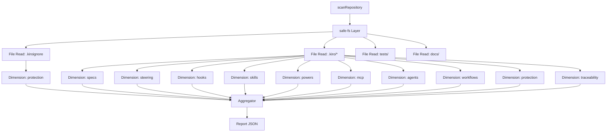

# Diseño — radar-core

## Resumen

**WP-02:** Diseño del motor de puntaje de Kiro Radar.

Kiro Radar escanea un repositorio y puntúa su uso de Kiro en 10 dimensiones. Este diseño define `packages/core` como módulo único con una función pública `scanRepository(root: string): Promise<Report>`.

Principio central: **presencia no es calidad**. Un archivo vacío o con solo título da 0 puntos.

Repositorios de prueba:
- `fixtures/excellent`: puntaje alto (≥80)
- `fixtures/minimal`: puntaje bajo pero válido (≥20)
- `fixtures/trap`: repositorio vacío, puntaje ≤20

Salida determinista, compatible con Windows, sin dependencias de ejecución salvo justificación.

---

## Arquitectura



### Capas

| Capa | Responsabilidad |
|------|-----------------|
| `scanRepository` | Orquesta el escaneo, coordina dimensiones, construye reporte |
| `safe-fs` | Centraliza lecturas: validación de rutas, límites, UTF-8, binarios, enlaces |
| `dimensions/` | Una clase por dimensión, implementa `score(ctx: DimensionContext): DimensionResult` (sincrónica) |
| `aggregator` | Suma puntajes, calcula totalScore, ordena arrays, construye reporte final |

### Principios de diseño

- **Inmutabilidad:** `scanRepository` no modifica el repositorio escaneado.
- **Aislamiento:** Cada dimensión lee solo lo que le corresponde, sin dependencias entre sí.
- **Propagación de warnings:** Errores no fatales se registran en `warnings` del reporte, no detienen el escaneo.
- **Orden determinista:** Dimensiones procesadas por code units (sin localeCompare); arrays ordenados por code units.
- **Sin lógica de negocio fuera de dimensiones:** Las reglas de puntaje viven en `dimensions/`.

---

## Flujo de escaneo

```
1. validateRoot(root: string): string
   - Normalizar rutas (barra normal, sin trailing slash)
   - Validar que es un directorio
   - Resolver a ruta absoluta

2. readAllFiles(root: string): FileRecord[]
   - safe-fs recorre directorios
   - Límite 1 MiB por archivo
   - Rechazar enlaces simbólicos (lstat + realpath)
   - UTF-8 con detección de binarios
   - Warnings por enlaces, archivos grandes, decodificación fallida

3. scoreDimensions(root: string, files: FileRecord[]): DimensionResult[]
   - Por cada dimensión (ordena alfabéticamente)
   - Invocar dimension.score(root, files)
   - Capturar warnings de la dimensión

4. aggregate(root: string, dimensionResults: DimensionResult[]): Report
   - totalScore = suma de scores
   - dimensions ordenadas por name
   - warnings concatenadas y deduplicadas

5. return Report
```

---

## Interfaz pública

### `scanRepository(root: string): Promise<Report>`

```typescript
export type DimensionName = "agents" | "hooks" | "mcp" | "powers" | "protection" | "skills" | "specs" | "steering" | "traceability" | "workflows";

export interface Report {
  /** Versión del schema del reporte */
  schemaVersion: string;
  /** Nombre de la carpeta del repositorio (no ruta absoluta) */
  repoName: string;
  /** Suma de los puntajes de las 10 dimensiones (0–100) */
  totalScore: number;
  /** Resultados de cada dimensión */
  dimensions: DimensionResult[];
  /** Advertencias encontradas durante el escaneo */
  warnings: string[];
}

export interface DimensionResult {
  /** Nombre de la dimensión (union literal de 10 valores) */
  name: DimensionName;
  /** Puntaje de la dimensión (0–10) */
  score: number;
  /** Hallazgos concretos que justifican el puntaje */
  evidence: string[];
  /** Sugerencia de acción para mejorar */
  nextAction: string;
}
```

### Reglas del contrato

- `schemaVersion`: `"1.0.0"` (no cambia sin ruptura)
- `repoName`: solo nombre de carpeta, sin ruta
- `totalScore`: siempre entero 0–100, igual a `dimensions.reduce((sum, d) => sum + d.score, 0)`
- `dimensions`: array exactamente 10 elementos, ordenado alfabéticamente por `name`
- `warnings`: array de strings, ordenados por code units (sin localeCompare), sin duplicados
- `evidence`: máximo 120 caracteres por entrada; rutas relativas a la raíz con barras normales

---

## Modelo de datos

### Tipos base

```typescript
type FilePath = string;
type FileContent = string;
type FileSize = number;

interface FileRecord {
  path: FilePath;
  content: FileContent | null; // null si binario o error
  size: FileSize;
  isBinary: boolean;
  isSymlink: boolean;
  symlinkTarget?: FilePath;
}

/** Función de puntaje intermedio por dimensión:
 *  - Sin requisitos mínimos: 0
 *  - Cumplimiento parcial (≥6): entre 1 y 5 según criterios cumplidos
 *  - ≥6 completo: 6
 *  - Cada criterio adicional de 10 suma proporcional hasta 9
 *  - Todos cumplidos: 10
 */
function intermediateScore(criteriosCumplidos: number, maxCriterios: number): number {
  if (criteriosCumplidos === 0) return 0;
  if (criteriosCumplidos === maxCriterios) return 10;
  if (criteriosCumplidos >= 1 && criteriosCumplidos < maxCriterios / 2) return 1;
  if (criteriosCumplidos >= maxCriterios / 2 && criteriosCumplidos < maxCriterios) return 2 + Math.floor((criteriosCumplidos / maxCriterios) * 4);
  return 9;
}

interface ScoreThreshold {
  /** Umbral para 0 puntos */
  zero: ScoreCriteria;
  /** Umbral para ≥6 puntos */
  six: ScoreCriteria;
  /** Umbral para 10 puntos */
  ten: ScoreCriteria;
}

interface ScoreCriteria {
  /** Número mínimo de archivos con contenido real */
  minFiles?: number;
  /** Número mínimo de caracteres con contenido real */
  minCharacters?: number;
  /** Archivos obligatorios */
  requiredFiles: string[];
  /** Atributos JSON que deben existir */
  requiredAttributes?: string[];
  /** Cantidad mínima de items en una lista */
  minItems?: number;
  /** Criterios específicos por dimensión */
  custom?: Record<string, unknown>;
}
```

### Estructura interna de dimensiones

```typescript
interface DimensionContext {
  root: string;
  files: FileRecord[];
  warnings: string[];
}

interface DimensionResultInternal {
  name: string;
  score: number;
  evidence: string[];
  nextAction: string;
}
```

---

## Estrategia por dimensión

Cada dimensión implementa una interfaz común:

```typescript
export interface Dimension {
  readonly name: string;
  score(ctx: DimensionContext): DimensionResultInternal;
}
```

### 1. specs

**Ruta:** `.kiro/specs/`

**Reglas:**
- Archivo con contenido real: ≥200 caracteres no vacíos fuera de títulos y frontmatter.
- 0 puntos: sin specs con contenido real.
- ≥6 puntos: al menos 1 spec con `requirements.md`, `design.md` y `tasks.md`, todos con contenido real, y al menos 3 líneas `WHEN` con `SHALL`.
- 10 puntos: 2+ specs así y al menos una tarea marcada `[x]`.

**Evidencia:** lista de specs encontrados con su contenido relevante.

**Acción sugerida:** crear o completar specs faltantes.

---

### 2. steering

**Ruta:** `.kiro/steering/`

**Reglas:**
- Archivo con contenido real: ≥200 caracteres.
- 0 puntos: sin archivos con contenido real.
- ≥6 puntos: `product.md`, `tech.md` y `structure.md` con contenido real y 2 modos de `inclusion`.
- 10 puntos: los tres más los 4 modos (`always`, `auto`, `fileMatch`, `manual`).

**Evidencia:** lista de archivos y su atributo `inclusion`.

**Acción sugerida:** crear o completar archivos fundacionales.

---

### 3. hooks

**Ruta:** `.kiro/hooks/`

**Reglas:**
- 0 puntos: sin JSON v1 válido.
- ≥6 puntos: 2+ triggers distintos y al menos uno bloqueante (`PreToolUse`, `UserPromptSubmit`, `PreTaskExec`).
- 10 puntos: 4+ triggers distintos, 2+ hooks bloqueantes y todos con `action.command` o `action.prompt`.

**Evidencia:** lista de triggers y sus tipos (bloqueante/no bloqueante).

**Acción sugerida:** agregar hooks faltantes.

---

### 4. skills

**Ruta:** `.kiro/skills/*/SKILL.md`

**Reglas:**
- 0 puntos: sin SKILL.md con contenido real.
- ≥6 puntos: una skill con `name` igual a la carpeta y `description` de ≥40 caracteres.
- 10 puntos: 3+ skills así y al menos una con `scripts/`, `references/` o `assets/`.

**Evidencia:** lista de skills con sus atributos verificados.

**Acción sugerida:** corregir `name` o completar descripción.

---

### 5. mcp

**Ruta:** `.kiro/settings/mcp.json`

**Reglas:**
- 0 puntos: sin `mcp.json` válido.
- ≥6 puntos: 1+ servidores en `mcpServers`.
- 10 puntos: 2+ servidores o uno con `env` usando variables `${...}`, y cero secretos literales (cualquier secreto literal limita a 3).

**Evidencia:** lista de herramientas MCP y su validación. El evidence nunca incluye el valor de un secreto, solo el nombre de la clave (ej. "VITE_API_URL" no "https://api.example.com/...").

**Acción sugerida:** agregar herramientas o variables.

---

### 7. agents

**Ruta:** `.kiro/agents/`

**Reglas:**
- 0 puntos: sin perfiles válidos.
- ≥6 puntos: 1+ perfiles con `tools` sin comodín y `resources`.
- 10 puntos: 3+ perfiles así y con `permissions.rules`.

**Evidencia:** lista de agentes y sus recursos.

**Acción sugerida:** crear o completar agentes.

---

### 8. workflows

**Ruta:** `.kiro/workflows/`

**Reglas:**
- 0 puntos: sin recetas válidas.
- ≥6 puntos: una receta con 2+ nodos.
- 10 puntos: una receta con `repeat` y `parallel`.

**Evidencia:** lista de workflows y sus nodos.

**Acción sugerida:** crear o completar workflows.

---

### 9. protection

**Ruta:** `.kiroignore`, permisos, hooks de guardia

**Reglas:**
- 0 puntos: sin `.kiroignore` ni hook bloqueante.
- ≥6 puntos: `.kiroignore` con contenido y un hook bloqueante.
- 10 puntos: lo anterior, 2+ hooks bloqueantes y al menos un agente con `permissions.rules`.

**Evidencia:** lista de archivos de protección.

**Acción sugerida:** agregar `.kiroignore` o hooks.

---

### 10. traceability

**Ruta:** `tests/` y `docs/evidence/`

**Reglas:**
- 0 puntos: sin tests.
- ≥6 puntos: tests presentes y un archivo de evidencia con ≥1 línea.
- 10 puntos: lo anterior, `tests/e2e/` con tests y tareas referenciadas en la evidencia.

**Evidencia:** lista de tests y evidencia.

**Acción sugerida:** agregar tests o evidencia.

---

## Manejo de errores

### Errores fatales (incluyen `error` en reporte)

| Error | Comportamiento |
|-------|----------------|
| Raíz inexistente o no es directorio | `error: "Raíz no es un directorio válido"` |
| Error de E/S irreparable (permiso denegado, disco lleno) | `error: "Error de sistema de archivos: ${message}"` |

### Errores no fatales (incluyen en `warnings`)

| Error | Comportamiento |
|-------|----------------|
| Archivo ausente | Dimensión asigna 0, continúa |
| Archivo con solo título (sin contenido real) | Dimensión asigna 0, continúa |
| Archivo JSON mal formado | Dimensión asigna 0 a ese archivo, warning registrada, continúa |
| Archivo > 1 MiB | Solo se leen primeros 1 MiB, warning registrada, continúa |
| Archivo binario detectado | `content: null`, warning registrada, continúa |
| Enlace simbólico que apunta fuera del repositorio | Warning registrada, se ignora y continúa |
| Enlace simbólico (sin seguir) | Warning registrada, continúa |

### Reglas de validación

- Todo error no fatal debe dejar `report.error === undefined`.
- Todo error fatal debe incluir `error` en el reporte y detener procesos no esenciales.
- Warnings nunca bloquean el escaneo.

---

## Seguridad

### Restricciones de safe-fs

```typescript
const MAX_FILE_SIZE = 1024 * 1024; // 1 MiB
const MAX_DEPTH = 20;
const MAX_FILES = 20000;
const IGNORE_PATTERNS = [".git", "node_modules"];

interface SafeFSConfig {
  /** Tamaño máximo por archivo (1 MiB) */
  maxFileSize: number;
  /** Máxima profundidad de recursión */
  maxDepth: number;
  /** Rutas explícitamente excluidas */
  ignorePatterns: string[];
}
```

**Validaciones:**
- `realpath` detecta enlaces circulares (lanza error).
- Rutas absolutas normalizadas antes de comparar.
- `path.relative(realRoot, realChild)` rechaza si empieza por `..` o es absoluta, para que root-evil no pase.
- Comparación insensible a mayúsculas solo en `win32`.
- Enlaces simbólicos que apuntan fuera del repositorio se ignoran con warning y continúa el escaneo.
- Se ignora `.git` y `node_modules` durante el recorrido, con warning si se alcanzan límites.
- Warning si se superan los 20000 archivos límite.

### Bloqueo de ejecución

- **Nunca** se ejecuta código del repositorio escaneado.
- **Nunca** se salen del directorio raíz.
- **Nunca** se siguen enlaces simbólicos (`lstat` detecta, `realpath` valida).
- Archivos binarios se marcan y se omite su análisis.

### Precauciones adicionales

- Límite de lectura 1 MiB por archivo para evitar DoS por archivos gigantes.
- UTF-8 decodificación con reemplazo de caracteres inválidos (no lanzar).
- Sin ejecución de hooks o scripts del repositorio escaneado.

---

## Compatibilidad con Windows

### Rutas

- Normalización: `path.normalize` seguido de reemplazo `\\` → `/`.
- Sin trailing slash (ej. `C:\dev\repo` no `C:\dev\repo\`).
- Sin `~` ni variables de entorno (solo rutas absolutas).

### Encoding

- UTF-8 con BOM permitido.
- Si detecta secuencia inválida, reemplazar con `�` y continuar.
- No usar `iconv` ni dependencias externas (Node.js nativo es suficiente).

### Pruebas en Windows

- Fixture con rutas que contienen espacios: `fixtures/excellent with spaces/`
- Fixture con acentos: `fixtures/excellent-acentos/`
- Fixture trampa: `fixtures/trap/`

Las pruebas crean carpetas temporales para rutas con espacios, acentos y enlaces; nunca usan `fixtures/` como base.

### Variables de entorno

- `process.platform === "win32"` no afecta lógica.
- Rutas de fixtures se construyen con `path.join`.

---

## Plan de pruebas

### Unit tests (`packages/core/src/dimensions/*.test.ts`)

Cada dimensión tiene un bloque mínimo:

```typescript
describe("dimension: <name>", () => {
  test("0 puntos: sin archivos", async () => {
    const ctx = makeContext("fixtures/minimal/no-files");
    const result = await new <DimensionClass>().score(ctx);
    expect(result.score).toBe(0);
  });

  test("≥6 puntos: archivo con contenido mínimo", async () => {
    const ctx = makeContext("fixtures/minimal/<dimension>");
    const result = await new <DimensionClass>().score(ctx);
    expect(result.score).toBeGreaterThanOrEqual(6);
    expect(result.score).toBeLessThan(10);
  });

  test("10 puntos: contenido sobresaliente", async () => {
    const ctx = makeContext("fixtures/excellent/<dimension>");
    const result = await new <DimensionClass>().score(ctx);
    expect(result.score).toBe(10);
  });

  test("repositorio trampa: puntaje bajo", async () => {
    const ctx = makeContext("fixtures/trap");
    const result = await new <DimensionClass>().score(ctx);
    expect(result.score).toBeLessThanOrEqual(3);
  });
});
```

### Propiedades con fast-check

Las propiedades usan `fc.assert(fc.asyncProperty(...))` de `fast-check` directamente (H3). No se importa `vitest-fast-check` ni `@fast-check/vitest`.

Se fija `fc.configureGlobal({ seed: 42, numRuns: 100 })` al inicio del módulo para que los fallos sean reproducibles en CI (H5).

#### Generador de árbol de repositorio (H1, H2)

El árbol se genera como `Record<string, string>` (ruta relativa → contenido). El nombre de la carpeta raíz **no** es parte del arbitrario: cada corrida crea su propia carpeta con `fs.mkdtemp` y la borra en `finally` para evitar contaminación (H2).

```typescript
import * as fc from "fast-check";
import * as fs from "node:fs/promises";
import * as path from "node:path";
import * as os from "node:os";
import { scanRepository } from "../index.js";

// Fijar seed para reproducibilidad en CI (H5)
fc.configureGlobal({ seed: 42, numRuns: 100 });

// ── Arbitrarios de contenido ────────────────────────────────────────────────

/** Líneas EARS: "WHEN <sujeto> SHALL <verbo> <objeto>" */
const earsSentence = fc.tuple(
  fc.lorem({ maxCount: 3 }),
  fc.lorem({ maxCount: 4 })
).map(([s, v]) => `WHEN ${s} SHALL ${v}`);

/** Frontmatter YAML válido */
const validFrontmatter = fc
  .constantFrom("always", "auto", "manual", "fileMatch")
  .map((mode) => `---\ninclusion: ${mode}\n---\n`);

/** Contenido markdown: mix de títulos, líneas EARS y párrafos */
const markdownContent = fc
  .tuple(
    fc.array(earsSentence, { minLength: 0, maxLength: 5 }),
    fc.lorem({ maxCount: 10 })
  )
  .map(([ears, prose]) => `# Título\n\n${ears.join("\n")}\n\n${prose}\n`);

/** JSON válido de hooks (puede tener 0 o más triggers) */
const hooksJson = fc
  .array(
    fc.record({
      type: fc.constantFrom("PreToolUse", "PostToolUse", "UserPromptSubmit"),
      action: fc.record({ command: fc.lorem({ maxCount: 2 }) }),
    }),
    { minLength: 0, maxLength: 4 }
  )
  .map((triggers) => JSON.stringify({ version: 1, hooks: triggers }, null, 2));

/** JSON inválido (simula archivo corrupto) */
const invalidJson = fc.string({ minLength: 1 }).filter((s) => {
  try { JSON.parse(s); return false; } catch { return true; }
});

// ── Generador de árbol (H1) ─────────────────────────────────────────────────

/**
 * Produce un Record<rutaRelativa, contenido> con subconjunto de rutas conocidas
 * de .kiro/**. El contenido varía en cada ejecución; el nombre de carpeta raíz
 * no forma parte del arbitrario (H2).
 */
const repoTreeArbitrary = fc.record({
  ".kiro/specs/main/requirements.md": fc.oneof(markdownContent, fc.constant("# Solo título")),
  ".kiro/specs/main/design.md":       fc.oneof(markdownContent, fc.constant("")),
  ".kiro/specs/main/tasks.md":        fc.oneof(markdownContent, fc.constant("# Tareas")),
  ".kiro/steering/product.md":        fc.oneof(
    fc.tuple(validFrontmatter, markdownContent).map(([fm, md]) => fm + md),
    fc.constant("# Producto")
  ),
  ".kiro/steering/tech.md":           fc.oneof(
    fc.tuple(validFrontmatter, markdownContent).map(([fm, md]) => fm + md),
    fc.constant("")
  ),
  ".kiro/hooks/hooks.json":           fc.oneof(hooksJson, invalidJson, fc.constant("{}")),
  ".kiro/settings/mcp.json":          fc.oneof(
    fc.constant(JSON.stringify({ mcpServers: { demo: { command: "node", args: [] } } })),
    fc.constant("{}")
  ),
});

/** Árbol trampa: solo archivos vacíos o solo títulos (H4) */
const trapTreeArbitrary = fc.record({
  ".kiro/specs/main/requirements.md": fc.constantFrom("# Requisitos", "", "---\ntitle: test\n---\n"),
  ".kiro/steering/product.md":        fc.constantFrom("# Producto", ""),
  ".kiro/hooks/hooks.json":           fc.constantFrom("{}", "{ }"),
  ".kiro/settings/mcp.json":          fc.constantFrom("{}", "null"),
});

// ── Helper: crear/borrar árbol en disco ─────────────────────────────────────

async function withRepoTree(
  tree: Record<string, string>,
  fn: (root: string) => Promise<void>
): Promise<void> {
  // Carpeta única por corrida; el nombre lo elige el SO, no fast-check (H2)
  const root = await fs.mkdtemp(path.join(os.tmpdir(), "kiro-radar-prop-"));
  try {
    for (const [rel, content] of Object.entries(tree)) {
      const abs = path.join(root, rel);
      await fs.mkdir(path.dirname(abs), { recursive: true });
      await fs.writeFile(abs, content, "utf-8");
    }
    await fn(root);
  } finally {
    await fs.rm(root, { recursive: true, force: true }); // limpieza siempre (H2)
  }
}

// ── Propiedades ──────────────────────────────────────────────────────────────

it("prop: determinismo — misma entrada produce mismo output", async () => {
  await fc.assert(
    fc.asyncProperty(repoTreeArbitrary, async (tree) => {
      await withRepoTree(tree, async (root) => {
        const report1 = await scanRepository(root);
        const report2 = await scanRepository(root);
        expect(JSON.stringify(report1)).toBe(JSON.stringify(report2));
      });
    })
  );
});

it("prop: totalScore es suma exacta de dimensiones", async () => {
  await fc.assert(
    fc.asyncProperty(repoTreeArbitrary, async (tree) => {
      await withRepoTree(tree, async (root) => {
        const report = await scanRepository(root);
        const sum = report.dimensions.reduce((acc, d) => acc + d.score, 0);
        expect(report.totalScore).toBe(sum);
      });
    })
  );
});

it("prop: puntaje de cada dimensión está en rango 0–10", async () => {
  await fc.assert(
    fc.asyncProperty(repoTreeArbitrary, async (tree) => {
      await withRepoTree(tree, async (root) => {
        const report = await scanRepository(root);
        for (const dim of report.dimensions) {
          expect(dim.score).toBeGreaterThanOrEqual(0);
          expect(dim.score).toBeLessThanOrEqual(10);
        }
      });
    })
  );
});

it("prop: repositorio trampa — totalScore ≤ 20 y ninguna dimensión ≥ 4", async () => {
  // H4: verifica ambas condiciones del criterio 3
  await fc.assert(
    fc.asyncProperty(trapTreeArbitrary, async (tree) => {
      await withRepoTree(tree, async (root) => {
        const report = await scanRepository(root);
        expect(report.totalScore).toBeLessThanOrEqual(20);
        for (const dim of report.dimensions) {
          expect(dim.score).toBeLessThan(4); // ninguna dimensión llega a 4
        }
      });
    })
  );
});

it("prop: monotonía — agregar contenido real nunca baja el puntaje de una dimensión", async () => {
  // H5: comparar árbol base vs árbol con más contenido en specs
  const baseTree = fc.record({
    ".kiro/specs/main/requirements.md": fc.constant("# Requisitos"),
    ".kiro/steering/product.md":        fc.constant("# Producto"),
  });
  const enrichedTree = fc.record({
    ".kiro/specs/main/requirements.md": markdownContent,
    ".kiro/specs/main/design.md":       markdownContent,
    ".kiro/specs/main/tasks.md":        markdownContent,
    ".kiro/steering/product.md": fc.tuple(validFrontmatter, markdownContent)
      .map(([fm, md]) => fm + md),
  });
  await fc.assert(
    fc.asyncProperty(baseTree, enrichedTree, async (base, enriched) => {
      let baseScore = 0;
      let enrichedScore = 0;
      await withRepoTree(base, async (root) => {
        const r = await scanRepository(root);
        baseScore = r.dimensions.find((d) => d.name === "specs")?.score ?? 0;
      });
      await withRepoTree(enriched, async (root) => {
        const r = await scanRepository(root);
        enrichedScore = r.dimensions.find((d) => d.name === "specs")?.score ?? 0;
      });
      expect(enrichedScore).toBeGreaterThanOrEqual(baseScore);
    })
  );
});

it("prop: seguridad de rutas — ningún evidence.path sale de la raíz ni es absoluto", async () => {
  // H5: evidence paths deben ser relativos y no contener ".."
  await fc.assert(
    fc.asyncProperty(repoTreeArbitrary, async (tree) => {
      await withRepoTree(tree, async (root) => {
        const report = await scanRepository(root);
        for (const dim of report.dimensions) {
          for (const ev of dim.evidence) {
            // Si el evidence contiene una ruta (heurística: empieza con . o letra/)
            if (ev.startsWith(".") || ev.startsWith("/") || /^[A-Za-z]:/.test(ev)) {
              expect(path.isAbsolute(ev)).toBe(false);
              expect(ev).not.toMatch(/\.\.(\/|\\|$)/);
            }
          }
        }
      });
    })
  );
});
```

### Pruebas de integración (`tests/e2e/`)

1. `scan-repository.test.ts`: escanea fixtures y valida schema.
2. `windows-compatibility.test.ts`: rutas con espacios y acentos en carpetas temporales.
3. `trap-repo.test.ts`: validación de repositorio trampa.
4. `safe-fs.test.ts`: traversal, root-evil, enlace externo, binario, archivo >1 MiB y BOM.

---

## Criterios de aceptación

1. `scanRepository("fixtures/excellent")` da `totalScore` ≥ 80.
2. `scanRepository("fixtures/minimal")` da `totalScore` ≥ 20 y < 80.
3. `scanRepository("fixtures/trap")` da `totalScore` ≤ 20 **y ninguna dimensión individual alcanza 4** (`dim.score < 4` para toda dimensión).
4. Salida determinista (mismo input, mismo output byte por byte).
5. `totalScore === dimensions.reduce((sum, d) => sum + d.score, 0)`.
6. Sin dependencias de ejecución salvo justificación.
7. Warnings registradas en casos de archivos grandes, binarios, enlaces, etc.
8. Error fatal solo si el escaneo no puede completarse por una razón externa.

---

**Próxima etapa:** Implementación en `packages/core/src/`. Detener hasta aprobación de Henry.
